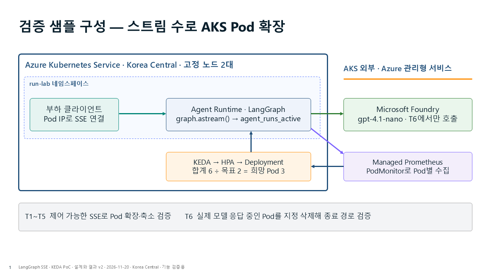
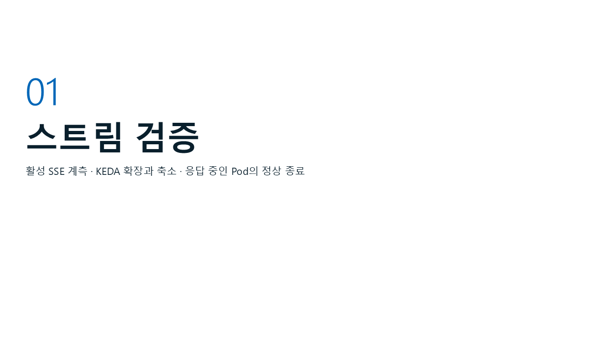
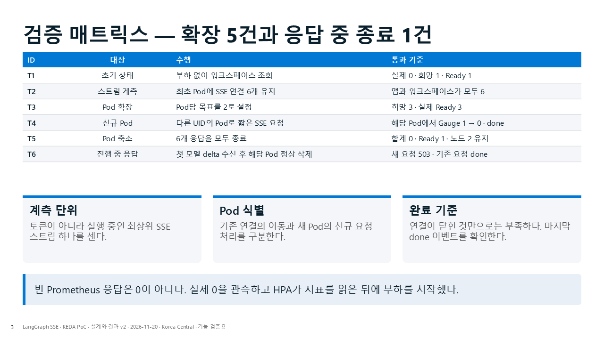
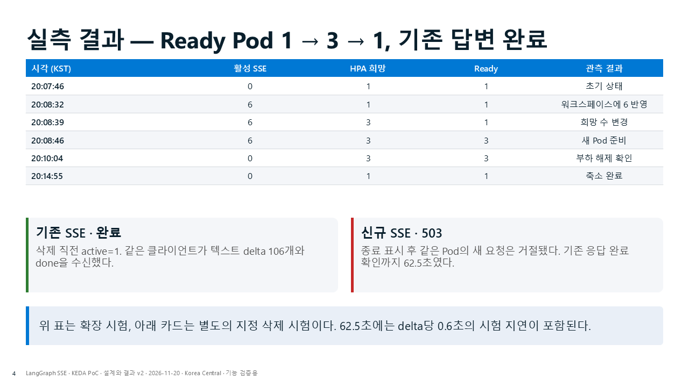
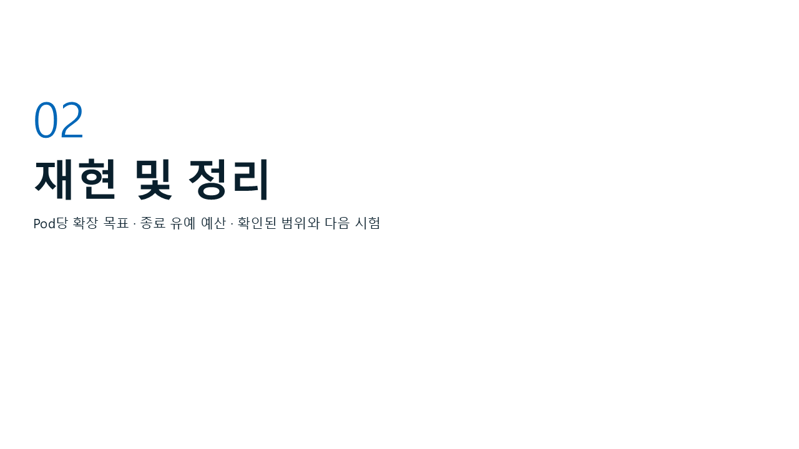
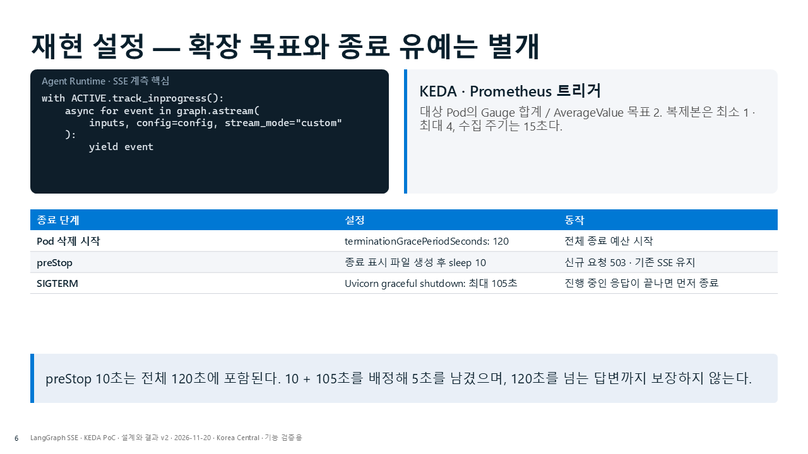
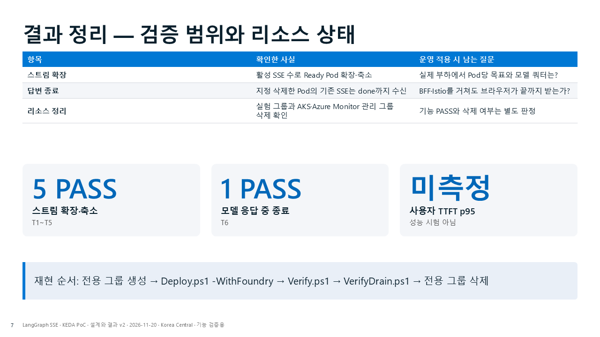

# AKS · LangGraph 활성 스트림 기반 KEDA 확장 검증

AKS에서 LangGraph가 처리 중인 SSE 응답 수로 Pod를 확장할 수 있는지, 응답 중인 Pod를 정상 삭제해도 기존 클라이언트가 마지막 이벤트를 받는지 검증했습니다. 기능 검증이며, 사용자 TTFT와 운영 용량은 측정하지 않았습니다.

- **확장·축소:** 제어 가능한 스트림 6개를 유지하자 Managed Prometheus의 합계가 6, Ready Pod가 3이 됐습니다. 부하 해제 후 Ready Pod는 1개로 돌아왔고 노드는 2대로 유지됐습니다.
- **종료 중 응답:** Foundry 모델의 첫 텍스트를 받은 Pod를 지정 삭제하자 **새 요청은 503**을 받았지만 **기존 요청은 텍스트 delta 106개와 `done`**을 받았습니다.

**결과: T1~T6 모두 PASS** (2026-11-20, Korea Central). 실험 후 전용 리소스 그룹, AKS 노드 그룹, Azure Monitor 관리 그룹의 삭제도 확인했습니다.

> **판정 시 주의:** Pod 수가 줄었다는 사실만으로 기존 답변의 완료를 알 수 없습니다. T6에서는 삭제한 Pod와 클라이언트를 특정하고, 연결 종료가 아니라 SSE의 마지막 `done`을 확인했습니다.

## 저장소 구성

| 경로 | 내용 |
|---|---|
| [장표](deck/) | 편집 가능한 PowerPoint, YAML 원본, 한국어 발표 노트, 슬라이드별 PNG |
| [설계](docs/superpowers/specs/2026-11-20-langgraph-aks-keda-design.md) · [구현 계획](docs/superpowers/plans/2026-11-20-langgraph-aks-keda.md) | 가설·범위·대안·구현 순서 |
| [실측 증적](evidence/README.md) | [SSE 확장 관측](evidence/sse-cycle.json) · [모델 응답 중 종료](evidence/model-drain.json) |
| [앱](app/) · [인프라](infra/) · [매니페스트](k8s/) | 에이전트와 부하 클라이언트, Azure 리소스, PodMonitor·KEDA 설정 |
| [스크립트](scripts/) · [자동 테스트](tests/) | 생성·배포·판정·정리와 회귀 테스트 |

## 장표

[편집 가능한 PowerPoint v2](deck/langgraph-keda-v2.pptx) · [YAML 원본](deck/langgraph-keda-v2.yaml) · [발표 노트](deck/langgraph-keda-v2.script.md) · [전체 미리보기](deck/langgraph-keda-v2_render/contact_sheet.png) · [이전 상세판 10장](deck/langgraph-keda.pptx)

### 1. 검증 샘플 구성

부하 클라이언트와 Agent Runtime은 AKS 내부에 있습니다. 활성 스트림 수는 Managed Prometheus를 거쳐 KEDA로 전달되고, Foundry 모델은 응답 중 종료 시험에서만 호출됩니다.

<a href="deck/langgraph-keda-v2_render/slide_01.png"></a>

### 01 스트림 검증

#### 2. 스트림 검증 섹션

<a href="deck/langgraph-keda-v2_render/slide_02.png"></a>

#### 3. 검증 매트릭스

<a href="deck/langgraph-keda-v2_render/slide_03.png"></a>

#### 4. 실측 결과

<a href="deck/langgraph-keda-v2_render/slide_04.png"></a>

### 02 재현 및 정리

#### 5. 재현 및 정리 섹션

<a href="deck/langgraph-keda-v2_render/slide_05.png"></a>

#### 6. 재현 설정

<a href="deck/langgraph-keda-v2_render/slide_06.png"></a>

#### 7. 결과 정리

<a href="deck/langgraph-keda-v2_render/slide_07.png"></a>

## 무엇을 어떻게 검증했나

`LangGraph 그래프 실행 → Pod별 agent_runs_active → PodMonitor → Azure Managed Prometheus → KEDA → HPA → Deployment`

| ID | 수행 및 판정 기준 | 결과 |
|---|---|---|
| T1 초기 상태 | 빈 응답은 제외하고 workspace에서 실제 `0`, HPA 희망 1, Ready 1을 확인 | PASS |
| T2 부하 계측 | 처음의 Pod 한 개에서 Run 6개를 유지하고 앱 Gauge와 workspace 합계가 모두 6인지 확인 | PASS |
| T3 확장 | 목표 2 Run/Pod에서 `ceil(6/2) = 3`. 희망 수만이 아니라 Ready도 3이 되어야 통과 | PASS |
| T4 신규 Pod | 원래 Pod와 UID가 다른 Pod에 짧은 Run을 보내 로컬 Gauge `1 → 0` 확인. 기존 Run 이동은 요구하지 않음 | PASS |
| T5 축소 | 부하를 해제한 뒤 workspace 실제 0, HPA 희망 1, Ready 1 복귀. 전 구간 노드 수 2 유지 | PASS |
| T6 응답 중 종료 | Foundry `gpt-4.1-nano` 첫 delta 이후 해당 Pod를 정상 삭제. 새 요청은 503, 기존 클라이언트는 106개 delta와 `done`을 수신. 삭제 요청부터 완료 확인까지 62.5초 | PASS |

T6은 축소 대상을 운에 맡기지 않고 **진행 중인 Pod를 지정 삭제**해 동일한 Kubernetes 종료 경로를 시험했다. `preStop`은 신규 스트림 거절 표시를 만들고 10초 대기한다. 이 10초는 Pod 전체 유예 120초에 포함된다. Uvicorn은 SIGTERM 후 최대 105초 동안 기존 요청을 기다린다. 모델 스트림에는 시험을 위해 delta당 0.6초 지연을 주었다. **62.5초는 모델 성능 수치가 아니며, 120초를 넘는 답변까지 보장하지 않는다.** Istio·BFF는 시험 경로에 없다. [SSE 확장 관측](evidence/sse-cycle.json) · [모델 종료 관측](evidence/model-drain.json)

### 최초 백그라운드 Run 버전 실측 (2026-11-20, KST)

| 최초 관측 시각 | workspace의 Run 합계 | HPA 희망 Pod | Ready Pod |
|---|---:|---:|---:|
| 19:12:37 | 0 | 1 | 1 |
| 19:12:53 | 6 | 1 | 1 |
| 19:13:08 | 6 | 3 | 2 |
| 19:13:15 | 6 | 3 | 3 |
| 19:14:32 | 0 | 3 | 3 |
| 19:19:24 | 0 | 1 | 1 |

워크스페이스에서 6이 처음 보이고 Ready 3까지 약 22초, 해제 후 0이 처음 보이고 Ready 1까지 약 4분 52초였다. 두 노드는 동일하게 유지되었다. 이는 폴링한 시각의 차이이지 확장 SLA가 아니다. 초기 온보딩에서 지표가 한동안 누락되어 실험 전용 `ama-metrics` 수집기를 재기동하고 **실제 0**이 수집된 뒤 부하를 시작했다. 빈 응답은 0으로 대체하지 않는다.

## 실행 (PowerShell 7.4 이상)

Azure CLI, Bicep, kubectl과 로그인된 테스트 구독이 필요하다. 실행자는 그룹 생성·역할 할당·ACR Build·AKS 자격 증명 조회 권한과 Azure Monitor workspace에 대한 `Monitoring Data Reader` 또는 이를 포함하는 데이터 조회 권한이 있어야 한다. ACR Tasks 빌드를 허용하는 구독, AKS·Azure Monitor workspace를 함께 지원하는 리전과 D4s_v5 2대 쿼터를 선택한다. 조직 정책이 로컬 AKS 자격 증명을 금지하는 구독에는 이 실습을 그대로 적용하지 않는다.

```powershell
$p = @{ SubscriptionId = (az account show --query id -o tsv); Region = 'koreacentral'; ResourceGroup = 'rg-runlab-demo' }
.\scripts\Lab.ps1 -Action Preview @p
# 여기서 구독·리전·예산을 확인하고 별도 승인을 받은 뒤에만 진행
.\scripts\Lab.ps1 -Action Create @p
.\scripts\Deploy.ps1 -WithFoundry  # T1~T5만 실행할 때는 스위치 생략
.\scripts\Verify.ps1
.\scripts\VerifyDrain.ps1  # -WithFoundry로 배포한 경우만
# 성공·실패와 관계없이 실험 전용 그룹을 확인한 후 삭제
.\scripts\Lab.ps1 -Action Remove @p
```

`-WithFoundry`는 실험 그룹에 키 인증을 끈 Foundry 계정, `stream-lab` 모델 배포(GlobalStandard, 사용량 과금), 서비스 계정 전용 Workload Identity와 추론 역할을 만든다. 고정된 공개 테스트 문장만 보내며 GlobalStandard는 한국 내 추론을 보장하지 않는다.

### Azure 리소스 없이 로컬 회귀 테스트 실행

Python 3.12와 Pester 5 이상이 필요하다. 아래 명령은 저장소 루트 기준이다.

```powershell
python -m venv .venv
.\.venv\Scripts\python -m pip install -r app\requirements.txt
.\.venv\Scripts\python -m unittest discover -s tests
Invoke-Pester .\tests
az bicep build --file infra\main.bicep --stdout | Out-Null
```

`.lab`은 Git에서 제외된다. kubeconfig는 자격 증명이므로 공유하지 않는다. 이 실습은 공유 클러스터에 적용하지 않는다. `.lab\evidence-*.json`은 시각별 원시 Run 합계와 HPA·Ready 수를 남긴다. 새 Pod에 직접 보낸 1건은 **신규 Pod 실행 가능성**의 증거이지 서비스의 부하 분산이나 기존 Run 이동의 증거가 아니다. 403이면 workspace 조회 권한·전파 시간을, 데이터가 없으면 PodMonitor와 수집 대상 라벨을, HPA가 지표를 읽지 못하면 KEDA operator의 federated credential을 확인한다.

비용에는 VM·디스크·네트워크·ACR·모니터링이 포함된다. **2시간은 예상 실험 시간이지 자동 삭제 시간이 아니다.** AKS와 workspace가 만드는 서비스 관리 그룹도 삭제 후 확인한다. 실험이 실패해 Run이 남으면 15분 뒤 타임아웃된다. `Remove`는 로컬 상태와 태그가 일치하는 전용 그룹 전체를 삭제하므로 다른 자원을 넣지 않는다.

[Azure Monitor와 KEDA](https://learn.microsoft.com/azure/azure-monitor/containers/integrate-keda) · [KEDA Prometheus scaler](https://keda.sh/docs/latest/scalers/prometheus/)
